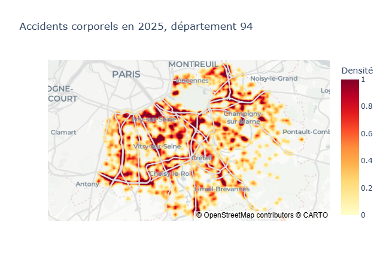
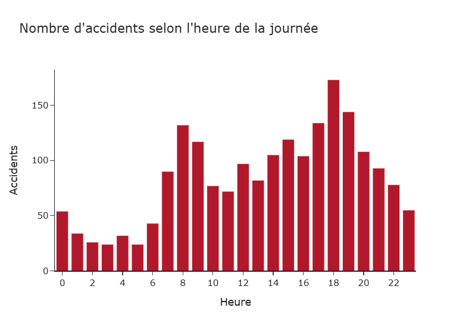

# Cartographie des accidents routiers en France

**Christella DAVID** — BUT Sciences des données, parcours VCOD — IUT Paris Rives de Seine

## Accidents corporels de la circulation en 2025 (Val-de-Marne, 94)

**Source :** [Bases de données annuelles des accidents corporels de la circulation routière – data.gouv.fr](https://www.data.gouv.fr/datasets/bases-de-donnees-annuelles-des-accidents-corporels-de-la-circulation-routiere-annees-de-2005-a-2025) (fichier « Caractéristiques » 2025, ONISR).

**Nettoyage :** suppression des accidents sans coordonnées GPS ou hors de France métropolitaine, filtre sur le département 94, création d'une colonne « heure ».

### Où ont lieu les accidents ?

Une carte de densité plutôt que des points : avec autant d'accidents, les points se cacheraient entre eux (règle 13). Palette simple du jaune au rouge et fond clair (règles 8 et 10).

### À quelle heure ont lieu les accidents ?

Un diagramme en barres, simple à comparer. Les barres suivent l'ordre des heures plutôt que d'être triées, car l'ordre des heures compte. Axe gradué toutes les 2 heures (règle 7) et un seul message par graphique (règle 16).

### Règles de lisibilité appliquées

- **Règle 7** : axe des heures simple, une graduation toutes les 2 heures.
- **Règle 8** : peu de couleurs, palette cohérente.
- **Règle 10** : fond clair, pas de décoration.
- **Règle 13** : carte de densité au lieu d'un nuage de points surchargé.
- **Règle 16** : un seul message par graphique.

### Interprétation

Les accidents se concentrent le long des grands axes et dans les zones les plus denses du département. Ils sont plus nombreux aux heures de trajet et rares la nuit : ils suivent surtout le trafic. Attention, ces graphiques comptent des accidents et non des risques : une zone très fréquentée aura plus d'accidents sans être forcément plus dangereuse.
