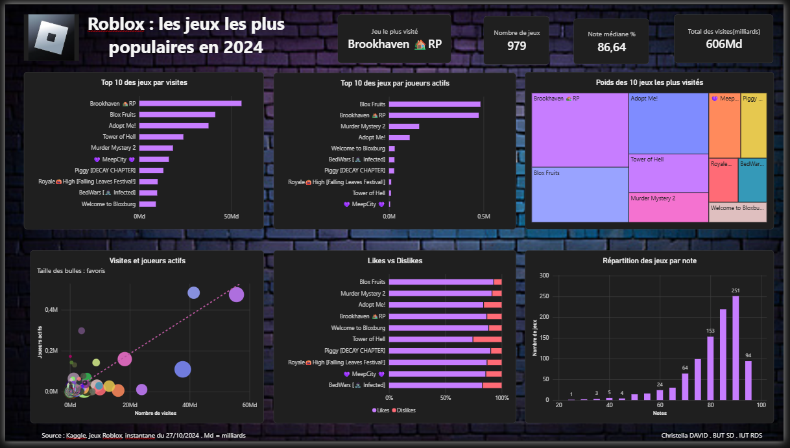

# Analyse du dashboard : Roblox, les jeux les plus populaires en 2024

## Ce qui fonctionne bien

Les KPI en haut de page donnent un résumé immédiat (jeu le plus visité, nombre de jeux, note médiane, total des visites) avant d'entrer dans le détail. Le thème sombre et violet est cohérent sur tous les visuels, ce qui donne une lecture homogène. Le nuage de points (visites vs joueurs actifs) utilise la taille des bulles pour ajouter une troisième variable (les favoris) sans surcharger le graphique.

## Ce qui pourrait être amélioré

- **Treemap (poids des 10 jeux les plus visités)** : plusieurs noms sont tronqués (« Meep… », « Royale… », « BedWar… »), ce qui nuit à la lisibilité.
- **Likes vs Dislikes** : le format 100 % empilé masque les écarts de volume réels. Deux jeux avec des pourcentages proches peuvent avoir un nombre total de likes très différent.
- **Répartition des jeux par note** : l'axe des notes commence à 20 et non à 0, ce qui peut fausser la perception des faibles effectifs sur les notes basses.

## Source

Kaggle, jeux Roblox, instantané du 27/10/2024.
