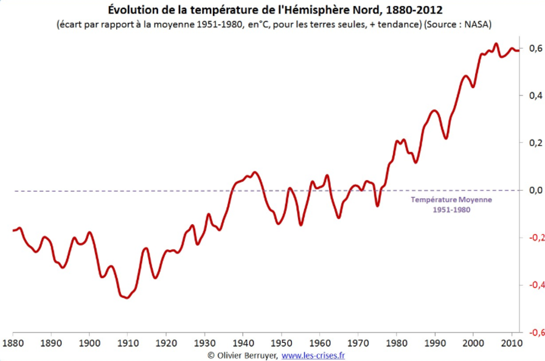
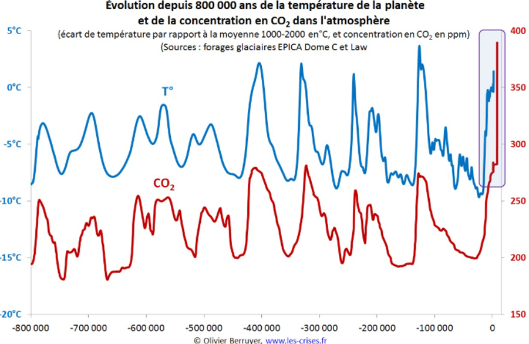

# Présentation de trois graphiques

## Graphique 1 : Évolution de la température de l'Hémisphère Nord (1880-2012)

Ce graphique utilise une seule courbe claire avec une ligne de référence (moyenne 1951-1980) qui permet de voir immédiatement si on est au-dessus ou en dessous de la moyenne. La tendance générale (réchauffement) se lit en un coup d'œil malgré les variations d'une année sur l'autre.

## Graphique 2 : Température et CO2 sur 800 000 ans

Les deux courbes (température et CO2) sont bien distinguées par leur couleur et suivent chacune leur propre axe, ce qui permet de comparer leurs évolutions sans les confondre. La zone encadrée sur la période récente attire efficacement l'attention sur la hausse rapide et inhabituelle par rapport aux cycles précédents.

## Graphique 3 : Naissances et décès en France métropolitaine

.png)

Les deux courbes (naissances et décès) sont bien différenciées par leur couleur et une légende simple, ce qui permet de les suivre facilement sur plus d'un siècle. L'axe des années est régulier et bien lisible, ce qui permet de repérer facilement des événements marquants comme la baisse des naissances pendant les guerres.
